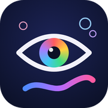

# まなざしアトリエ（見つめて えがく）

見つめたところに色が広がる、視線入力のお絵描きアプリです。マウスやトラックボール、タブレットの指でも描けます。

**[▶ アプリを開く](https://toitoitoi-lab.github.io/manazashi-atelier/)**

## できること

- 見つめたところに色が広がり、じっと見るとしゃぼん玉や花がふくらみます
- ボタンの並びは いろ → ふで → もよう。ふで6種類（ふで・いろえんぴつ・しゃぼん玉・きらきら・おはな・にじみ）、色8種類、左右対称・万華鏡のもよう。いろえんぴつは少しかすれます
- ふで・いろ・もようのボタンを見つめると一覧が開き、その中から見つめて選べます（本人が自分で切り替えられます）
- もどる・すすむ・けす（消しゴム）・リセットのボタンつき。リセットしても「もどる」で元に戻せます
- ペンを下ろす合図（見つめる・ゆっくりまばたき・クリック/スイッチ・合図なし）と、上げる合図を別々に選べます。ボタンの列のまわりの色の帯に目を移すか、反対側の角のかぎかっこ（または辺のバー、両方も可）を見つめるとペンが上がります。どこから描きはじめ、どこでやめるかを本人が決められます
- ボタンの列は上下左右の好きな辺に置け、数と大きさを変えられます（視線入力の子は大きく、マウスや指で描く子は小さく1列に）。ボタンのまわりはボタン専用の帯になり、絵の紙はその内側だけ。置く場所を変えると紙の範囲も自動で変わります
- ふつうのマウスは、1回クリックで描きはじめ、もう1回で止まります（押し続けなくてよい）。タブレットは指を付けている間だけ描きます
- 一覧や順番に出すふで・いろ・もようを支援者が2〜3にしぼれます
- はじめのふで・いろ・もようや、背景の色（パステルの見本や好きな色を足せます）を選べます
- カメラで使うときは、目をゆっくりとじて決める「ゆっくりまばたきで決定」も選べます（ふつうのまばたきでは決まりません）
- 入力方法を選べます：手で描く（マウス・トラックボール・指）／視線入力装置（PCにつなぐもの）／iPad・iPhone の視線トラッキング／カメラで目の動き／カメラで顔の向き（内蔵・外付けカメラ）。選ぶと、その入力に合う設定にそろいます
- 反応の速さ（すばやく反応・ふつう・ゆっくり安定＋スライダー）を選べ、設定画面の「ためし描き」でその場で確かめられます。大きく目を動かしたときはすぐ追いつき、じっと見ているときだけゆれをおさえます
- ボタンを押せるまでの時間、ボタンの位置・大きさ、だんだん消えるモードなどを支援者が合わせられます
- 作品は「写真に保存（JPEG）」で iPad・スマホの写真アプリに入れられます（PNG でも保存できます）
- 設定は「この子に合わせる／描きはじめ・やめ方／画面に出すもの／作品と記録」の4つにまとまっていて、ふだんは最初の1つだけで使えます
- 作品と「見ていた記録」（描いていた時間・見た範囲・画面9分割の割合）を残せます

## 使い方

1. 視線入力装置を使うときは、装置のソフトで「視線でマウスカーソルを動かす（マウスモード）」にします。iPad では「設定」→「アクセシビリティ」→「視線トラッキング」をオンにします。
2. アプリを開き、右上の歯車で入力方法や見え方を合わせます。
3. 「はじめる」を見つめて（またはクリックして）描きはじめます。
4. 歯車 →「画像にする」→「写真に保存」で写真アプリへ、「記録に追加」で作品と記録を残せます。

キーボード：Space やすむ／H 設定／S 画像にする／F 全画面／C 色／B ふで／Z もどる／Y すすむ／E けす／R リセット／Esc 閉じる

## 作品と記録の保存先

| | このページで開いたとき | 学校版（Google Apps Script） |
|---|---|---|
| 保存先 | この端末のブラウザの中（80件まで） | スプレッドシート＋Google ドライブ |
| いっぱいになったら | アーカイブ（zip またはフォルダ）として保存を案内 | 上限なし |

入力した内容とカメラの映像は、この端末の中だけで使います。サーバーには送りません。

## 学校版（Google Apps Script）で使う

`manazashi-atelier_v1.10.0_public.zip` をダウンロードし、中の「セットアップガイド」の手順B に沿って、自分の学校の Google アカウントで設定してください。Code.gs と index.html を貼り付け、`setup` を1回実行してウェブアプリとしてデプロイすると、作品と記録がスプレッドシートとドライブに保存されます。

## カメラで使うときの注意

- iPad・iPhone では、先に iPad の「視線トラッキング」をオフにしてください。どちらも同じ前面カメラを使うため、同時には使えません（iPad でのカメラは「ためし」の扱いです）。

- インターネット接続が必要です（顔を読み取るしくみ MediaPipe を読み込むため）。
- 「調整する（9点）」で、光る点を順に見て合わせます。精度は専用の視線入力装置より低いので、ふでを大きめにすると楽しみやすくなります。

## アイデア募集：顔の向きで描くときのペンの上げ下げ

「カメラ：顔の向き」で描くとき、ペンを下ろす・上げる合図にどんな動きが使いやすいか、まだよい方法が分かっていません（顔を動かして描いているので、うなずきなどの動きは描く動きと区別しにくいためです）。

実際に使っている方、支援している方で、アイデアや「こうしたらうまくいった」という経験があれば、[toi toi toi lab のお問い合わせ](https://toitoitoi-lab.github.io/contact/) から教えてください。

## ライセンス

コードは MIT ライセンスです。記事・教材やアプリの考え方を研修などで紹介するときは、[利用ルール](https://toitoitoi-lab.github.io/rules/) をご覧ください。

toi toi toi lab
